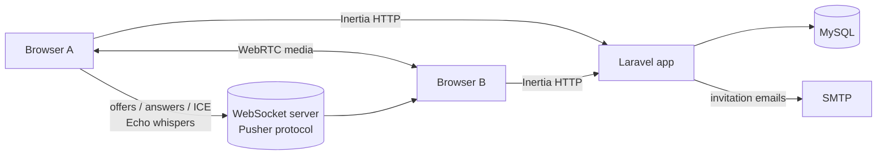

# LIU Meet

A group video-calling web app built with Laravel, React, WebRTC, and WebSockets, with meeting scheduling, email invitations, and screen sharing.

Students and instructors need a simple way to schedule a call, invite people, and join from the browser. LIU Meet handles scheduling and invitations on a Laravel backend and runs the calls themselves peer to peer over WebRTC. Signaling goes through Laravel Echo presence channels, so media streams travel directly between participants instead of through an application server.

## Features

- **Group video calls**: a mesh of WebRTC peer connections, one per participant.
- **Audio and video controls**: mute or unmute the microphone and hide or show the camera.
- **Screen sharing** via `getDisplayMedia`.
- **Network recovery**: connections restart ICE on failure, so a call can recover after a network switch (e.g. from mobile data to Wi-Fi, or after a Wi-Fi restart).
- **Live participant presence**: Echo presence channels track who joins and leaves a meeting.
- **Audio visualization**: a canvas sound-wave display for the local and remote audio streams.
- **Meeting scheduling**: create a meeting with a name, start and end time, and invitees. Each meeting gets a unique code.
- **Email invitations**: invitees receive a mail notification with a **Join Meeting** link.
- **Dashboard**: shows today's upcoming meetings that you own or were invited to, and lets you join a meeting by code (the code is checked before you join).
- **Accounts**: authentication from Laravel Breeze (register, login, email verification, password reset, profile management). Registration assigns a `student` or `instructor` role based on the LIU email format.

## Tech Stack

| Layer | Technology |
|---|---|
| Backend | PHP 8.1+, Laravel 10, Inertia.js, Laravel Sanctum, Ziggy |
| Frontend | React 18, TypeScript, Vite, Tailwind CSS, Chakra UI, PrimeReact |
| Real-time | WebRTC, Laravel Echo, Pusher protocol (`pusher-js`; local option: Soketi) |
| Database | MySQL |
| Testing | Pest |

## Architecture



- **Rendering**: Laravel serves React pages through Inertia (`Dashboard`, `Meeting`, `ScheduleMeetingForm`, and the auth and profile pages). SSR is configured.
- **Signaling**: `resources/js/hooks/useWebRTC.tsx` exchanges WebRTC negotiation messages as client events (whispers) on a `handshake.{meetingCode}` presence channel. Room membership is tracked on `meeting.{id}`.
- **ICE servers**: public STUN and TURN servers are configured in `useWebRTC.tsx`.
- **Data model**: `users` (with `role`), `meetings` (name, code, start and end time, owner), and `invitations` (meeting ↔ invitee).

## Getting Started

### Prerequisites

**Manual setup**

- PHP 8.1 or above
- MySQL 5.7 or above
- Nginx
- Composer
- Node.js 18 or above
- npm 8 or above
- A Pusher-compatible WebSocket server: a Pusher app, or [Soketi](https://soketi.app) run locally

**Or** use [Laravel Herd](https://herd.laravel.com/docs/1/getting-started/installation), which provides PHP and Nginx.

### 1. Configure the environment

```bash
cp .env.example .env
```

Fill in:

| Variable(s) | Purpose |
|---|---|
| `APP_URL` | App URL (the example uses `https://liu-meet.test`, a Herd-style domain) |
| `DB_HOST`, `DB_PORT`, `DB_DATABASE`, `DB_USERNAME`, `DB_PASSWORD` | MySQL connection |
| `BROADCAST_DRIVER` | Laravel broadcast driver. The frontend Echo client connects with the Pusher protocol |
| `PUSHER_APP_ID`, `PUSHER_APP_KEY`, `PUSHER_APP_SECRET`, `PUSHER_APP_CLUSTER`, `PUSHER_HOST`, `PUSHER_PORT`, `PUSHER_SCHEME` | WebSocket server credentials. They are exposed to the frontend through the matching `VITE_PUSHER_*` variables |
| `MAIL_*` | SMTP settings for verification and invitation emails |

### 2. Install dependencies and build

```bash
composer install
npm install
php artisan key:generate
npm run build
```

### 3. Run migrations

```bash
php artisan migrate
```

### 4. Run the application

```bash
php artisan serve
```

For frontend hot reload during development, run `npm run dev` in a second terminal.

### Optional: local WebSocket server (Soketi)

```bash
npm run socket:start
```

This starts Soketi with client messages enabled, which signaling needs because it relies on Echo whispers. Soketi must be installed globally first (`npm install -g @soketi/soketi`). Point the `PUSHER_*` variables at it.

### Running with Laravel Herd

Serve the project directory with Herd (see [Herd: Sites & Paths](https://herd.laravel.com/docs/1/getting-started/paths)), then follow steps 1–3 above.

### Tests

```bash
php artisan test
```

The feature tests cover authentication, registration, email verification, password reset and update, and profile management.

> Video calls need camera and microphone permissions, which browsers only grant on `https://` origins or `localhost`.

---

Built by [Chadi Choker](https://github.com/ChadiChoker) · [Portfolio](https://github.com/ChadiChoker/portfolio)
